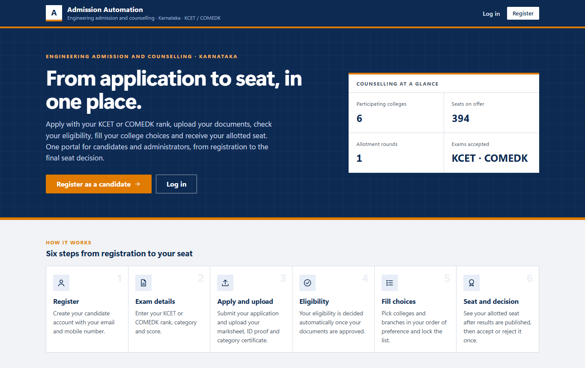
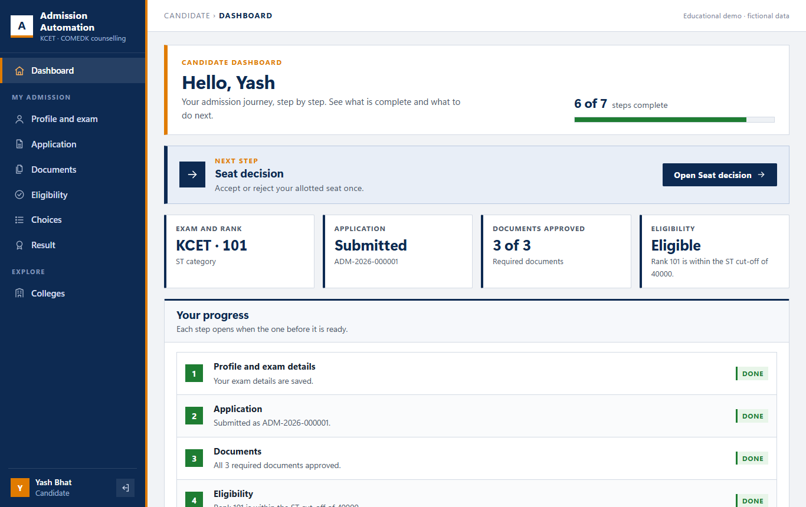
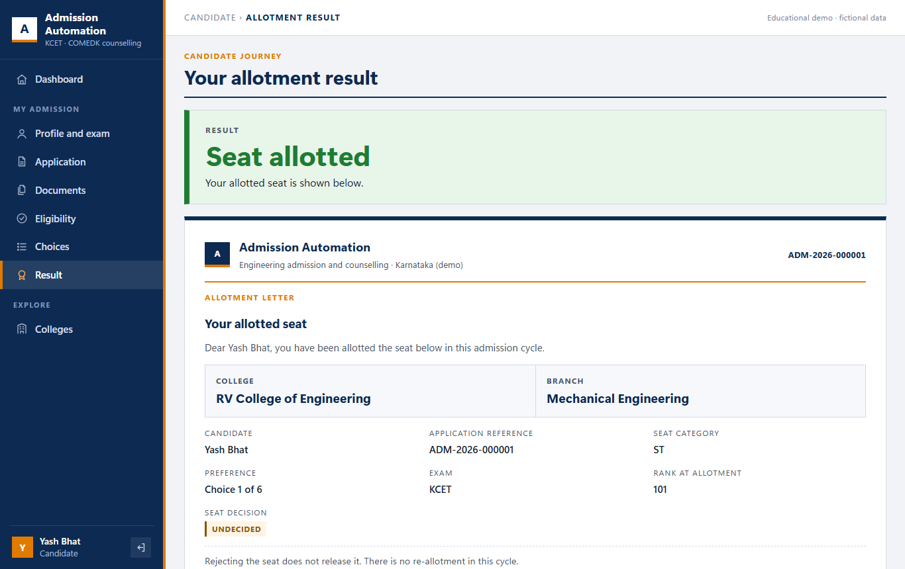
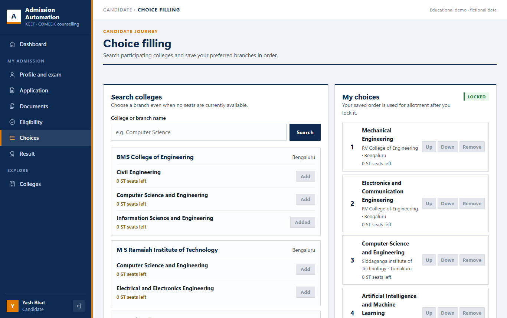
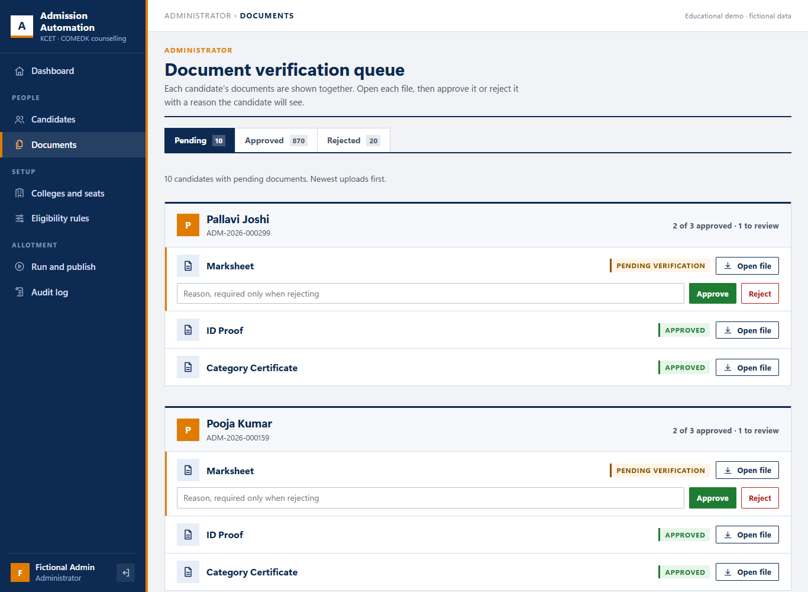
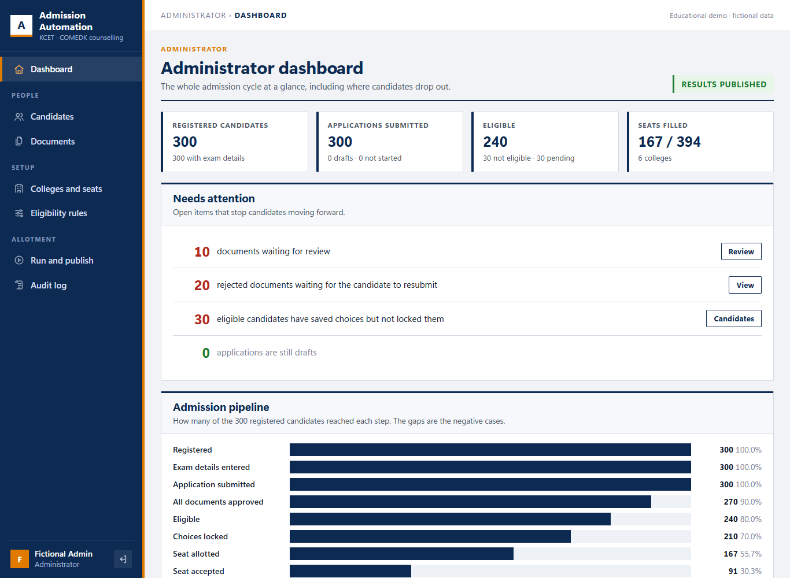
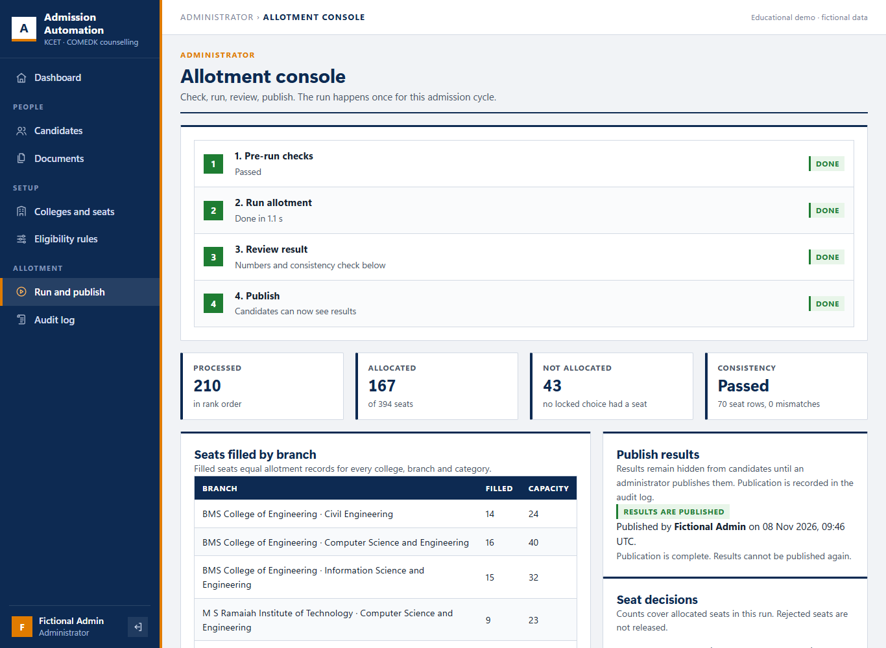
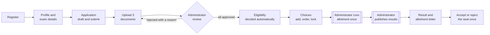

# Admission Automation

**One portal for engineering admission counselling, from registration to the final seat decision.**

Candidates apply with their KCET or COMEDK rank, upload documents, get an automatic eligibility decision, fill and lock their college choices, and accept or reject the seat they are allotted. Administrators verify documents, configure colleges, seats and cut-offs, run the seat allotment once, check it and publish the results.

[](https://github.com/Gagan-1718/SE-Team5-Admission-Automation/actions/workflows/ci.yml)


Software Engineering mini project · Team 5 · PES University · Educational demo with fictional data, not an official KEA or COMEDK system.



**Jump to:** [Screenshots](#screenshots) · [Demo videos](#demo-videos) · [How it works](#how-it-works) · [Features](#features) · [Run it](#run-it-locally) · [Testing](#testing-and-quality) · [Documents](#project-documents) · [Team](#team)

---

## At a glance

| | |
|---|---|
| **Complete cycle** | Registration → exam details → application → documents → eligibility → choices → allotment → publication → seat decision |
| **Two roles** | Candidate (7-step journey with a progress dashboard) and administrator (dashboard, review queue, configuration, allotment console, audit log) |
| **Ten modules** | accounts, application, documents, catalogue, eligibility, choices, allotment, results, audit, admin |
| **Tests** | 896 automated pytest tests, run by GitHub Actions on every push and pull request |
| **Coverage** | 95.46% statements, 89.74% branches ([coverage report](docs/testing/CODE_COVERAGE_REPORT.md)) |
| **Allotment speed** | 600 candidates in a median of 1.589 s against a 60 s limit ([evidence](docs/evidence/gagan.md)) |
| **Response time** | 25 concurrent candidates: page averages 331 to 525 ms against a 2 s target ([evidence](docs/evidence/tasya-response-time.md)) |

## Screenshots

All screens below come from the running application with the 300-candidate fictional demo dataset.

<table>
  <tr>
    <td width="50%"><br><b>Candidate dashboard:</b> every step of the journey and the next thing to do</td>
    <td width="50%"><br><b>Allotment letter:</b> the allotted college and branch, ready to print, then accept or reject once</td>
  </tr>
  <tr>
    <td width="50%"><br><b>Choice filling:</b> search colleges, add branches, order them and lock the list</td>
    <td width="50%"><br><b>Document review:</b> one card per candidate with all three documents</td>
  </tr>
  <tr>
    <td width="50%"><br><b>Administrator dashboard:</b> headline figures, needs-attention list and the admission pipeline</td>
    <td width="50%"><br><b>Allotment console:</b> check, run once, verify seat consistency, publish</td>
  </tr>
</table>

## Demo videos

| Sprint | Video |
|---|---|
| Sprint 1 | [Sprint1_Demo.mp4](Sprint1_Demo.mp4) |
| Sprint 2 | [Sprint2_Demo_Video.mp4](Sprint2_Demo_Video.mp4) |

## How it works



## Features

### For candidates

| Step | What the candidate does |
|---|---|
| 1. Register | Name, email, mobile, date of birth (16 or older) and password |
| 2. Profile and exam details | Enters KCET or COMEDK details; only records that exist in the seeded exam data are accepted, and they lock once the application is submitted |
| 3. Application | Saves a draft, comes back later, then submits and receives a reference such as `ADM-2026-000001` |
| 4. Documents | Uploads Marksheet, ID Proof and Category Certificate (PDF, JPEG or PNG, up to 2 MB); sees the reason for any rejection and uploads a corrected file |
| 5. Eligibility | Decided automatically: every document approved and the rank within the cut-off for the candidate's category, always with the reason |
| 6. Choices | Searches colleges and branches, adds them, reorders them and locks the list for the allotment |
| 7. Result and decision | Sees the allotted seat on a printable allotment letter (or Not Allocated) and accepts or rejects it once |

A dashboard shows every step as done, current, waiting, locked or needing attention, with the next thing to do.

### For administrators

- **Dashboard:** headline figures, the admission pipeline, outcome bars for applications, documents, eligibility, choices, allotment and seat decisions, seats filled by college, and a needs-attention list.
- **Candidates:** searchable list, 25 per page, with each application's status.
- **Document review:** one card per candidate with all three documents; approve, or reject with a reason the candidate sees.
- **Colleges and seats:** colleges, branches and a category-wise seat matrix (General, OBC, SC, ST, EWS).
- **Eligibility rules:** a cut-off rank per category that can be changed or switched off without touching code.
- **Allotment console:** pre-run checks, a single allotment run, a seat consistency check, then publication.
- **Audit log:** every privileged action and seat decision, newest first, filterable, and impossible to edit or delete.

### How the allotment decides

1. Candidates who are Eligible at run time and have locked their choices take part. Everyone else gets no result row, which is shown as "not part of this run", not as Not Allocated.
2. Candidates are processed in ascending rank; ties go to the lower application reference number.
3. Each candidate's choices are tried in their saved order, and a choice is satisfied only by a free seat in the candidate's own category.
4. The seat is taken immediately, before the next candidate is processed. A candidate with no satisfiable choice is Not Allocated.
5. The whole run (seat counts, results, run record, audit entry) is saved in one transaction or not at all, and there is exactly one allotment cycle.

### Security

| Area | How it is handled |
|---|---|
| Passwords | Salted, one-way scrypt hashes; never stored or logged in plain text |
| Sessions | Random token in an `HttpOnly`, `SameSite=Lax` cookie (`Secure` over HTTPS); only its SHA-256 hash is stored; expires after 8 hours; logout invalidates it on the server |
| Access control | Every candidate and administrator route checks the role: 401 when not signed in, 403 for the wrong role |
| CSRF | A session-bound token is required on every POST, PUT, PATCH and DELETE |
| Transport | HTTPS with TLS 1.2 or newer, HTTP redirected to HTTPS, HSTS header |
| Uploads | File type checked by content, size limit, random stored names in a private folder |
| Data rules in the database | Seats can never be filled beyond capacity; one decision per result; one allotment cycle; the audit log is append-only through SQLite triggers |

## Tech stack

| Layer | Choice |
|---|---|
| Language | Python 3.12 |
| Web framework | Flask 3.1 with Jinja templates |
| Database | SQLite through Flask-SQLAlchemy 3.1 and SQLAlchemy 2.1 |
| Front end | Server-rendered HTML, plain CSS and a little JavaScript (no framework) |
| Documents | Pillow and pypdf to validate uploads |
| HTTPS server | Cheroot with a locally generated self-signed certificate |
| Testing and CI | pytest, coverage.py and GitHub Actions |

## Run it locally

You need **Git** and **Python 3.12**.

### Windows (PowerShell)

```powershell
git clone https://github.com/Gagan-1718/SE-Team5-Admission-Automation.git
cd SE-Team5-Admission-Automation

py -3.12 -m venv .venv
.venv\Scripts\Activate.ps1
pip install -r requirements.txt

$env:ADMIN_SEED_PASSWORD = "admin123"         # any fictional password you like
$env:DEMO_CANDIDATE_PASSWORD = "pass1234"     # used by the demo dataset below

flask --app app init-db
flask --app app seed-db
python scripts/make_demo_dataset.py --candidates 300 --seed 1   # optional: 300 fictional candidates
flask --app app run
```

Open <http://127.0.0.1:5000/>. The health check is at <http://127.0.0.1:5000/health>. Press Ctrl+C to stop.

If PowerShell refuses to run `Activate.ps1`, skip activation and use `.venv\Scripts\python -m pip ...`, `.venv\Scripts\python -m flask ...` and `.venv\Scripts\python -m pytest` instead.

### macOS or Linux

```bash
git clone https://github.com/Gagan-1718/SE-Team5-Admission-Automation.git
cd SE-Team5-Admission-Automation
python3.12 -m venv .venv
source .venv/bin/activate
pip install -r requirements.txt
export ADMIN_SEED_PASSWORD="admin123" DEMO_CANDIDATE_PASSWORD="pass1234"
flask --app app init-db && flask --app app seed-db
python scripts/make_demo_dataset.py --candidates 300 --seed 1
flask --app app run
```

### Demo logins

With the values above:

| Email | Password | What it shows |
|---|---|---|
| `admin@example.test` | `admin123` | Administrator |
| `cand0001@example.test` | `pass1234` | Eligible candidate with locked choices |
| `cand0008@example.test` | `pass1234` | Not eligible: rank above the category cut-off |
| `cand0009@example.test` | `pass1234` | One document pending or rejected |
| `cand0010@example.test` | `pass1234` | Eligible, choices saved but not locked |

`make_demo_dataset.py` prints these logins when it finishes. It also writes the matching `document.approve` and `document.reject` entries to the audit log, so the audit page has data to show.

To show results, sign in as the administrator, open **Run and publish**, run the allotment, then publish. Use a private window for the second login, because one browser holds one session.

`seed-db` adds the administrator, the fictional exam records, the eligibility cut-offs and six real Karnataka engineering colleges (RV, BMS, PES, M S Ramaiah, Siddaganga, NIE). The college names are real so the demo reads naturally; every seat number is fictional.

<details>
<summary>Exam details you can enter when registering a new candidate by hand</summary>

Only these exact combinations exist in the seed data; anything else is refused.

| Exam | Rank | Category | Score |
|---|---|---|---|
| KCET | 1000 | General | 185.0 |
| KCET | 4500 | OBC | 160.5 |
| KCET | 12000 | SC | 140.0 |
| KCET | 15000 | ST | 132.5 |
| KCET | 9000 | EWS | 150.0 |
| KCET | 90000 | General | 60.0 |
| COMEDK | 800 | General | 190.0 |
| COMEDK | 6000 | OBC | 155.0 |

</details>

### Run it over HTTPS

```powershell
pip install -r requirements-https.txt
python scripts/serve_https.py
```

Open <https://localhost:8443/>. The browser warns that the certificate is self-signed; that is expected in the lab, so continue. Plain <http://localhost:8080/> redirects to HTTPS. Use `--https-port` and `--http-port` to change the ports. The certificate and key are created in `instance/certs/`, which Git ignores.

### Settings

| Environment variable | Purpose |
|---|---|
| `ADMIN_SEED_PASSWORD` | Password for `admin@example.test` when `seed-db` first creates it. If unset, a random one is generated and printed once |
| `DEMO_CANDIDATE_PASSWORD` | Password for every account made by `make_demo_dataset.py` (required by that script) |
| `DATABASE_URL` | Another database, for example `sqlite:///C:/temp/mine.db`. Default: `instance/team5_admission.db` |
| `SECRET_KEY` | Session signing key. If unset, a random key is created once in `instance/secret_key.txt` |

The `instance/` folder holds the database, uploads, certificate and secret key. It is ignored by Git and must never be committed.

### Database commands

| Command | What it does |
|---|---|
| `flask --app app init-db` | Creates any missing tables; never changes existing ones. Safe to repeat |
| `flask --app app init-db --reset` | Drops every table and recreates them. Local data is lost |
| `flask --app app seed-db` | Adds the fictional seed data. Safe to repeat; never resets an existing password |
| `flask --app app upgrade-document-references` | One-time upgrade for local databases created before 24 October 2026. Back up the database and uploads first |

## Testing and quality

```powershell
python -m pytest -q                      # the whole suite
pip install -r requirements-https.txt    # needed for the HTTPS tests, which are skipped otherwise
python scripts/time_allotment.py         # allotment timing on 300 fictional candidates (--candidates 600 for more)
python scripts/check_seat_consistency.py # seat counts must match the allotment records
```

Tests use a temporary database and never touch your local data.

| Check | Result | Evidence |
|---|---|---|
| Full suite on the final code (13 Nov 2026) | 896 passed, 0 failed, HTTPS tests included (Windows, Python 3.12.10) | [CI runs](https://github.com/Gagan-1718/SE-Team5-Admission-Automation/actions/workflows/ci.yml) |
| Full suite with coverage (8 Nov 2026) | 883 passed, then the 10 HTTPS tests passed | [Code coverage report](docs/testing/CODE_COVERAGE_REPORT.md) |
| Statement coverage | 95.46% (2545 of 2666 statements) | [Code coverage report](docs/testing/CODE_COVERAGE_REPORT.md) |
| Branch coverage | 89.74% (542 of 604 branches) | [Branch coverage report](docs/testing/BRANCH_COVERAGE_REPORT.md) |
| Unit tests | 61 passed, 0 failed | [Unit test report](docs/testing/UNIT_TEST_REPORT.md) |
| Allotment performance | 300 candidates: median 0.967 s; 600: 1.589 s (limit 60 s) | [Gagan's evidence](docs/evidence/gagan.md) |
| Response time | Sequential: 3 to 16 ms; 25 concurrent candidates: averages 331 to 525 ms (target 2 s) | [Response-time evidence](docs/evidence/tasya-response-time.md) |
| System validation | TC-001 to TC-030 mapped and recorded, limits stated | [System validation report](docs/testing/SYSTEM_VALIDATION_REPORT.md) |
| Defects | No Critical or High defect open | [Defect log](docs/DEFECT_LOG.md) |

A test case is recorded as passed only after it was actually run; the evidence for each owner is in [`docs/evidence/`](docs/evidence/).

## Project structure

```
app/
  __init__.py      application factory; loads each module's models, routes and seed data
  security.py      CSRF protection and security headers
  journey.py       the candidate journey contract used by the dashboard
  accounts/        registration, login, sessions, profile, exam details, candidate dashboard
  application/     application draft, submission and reference numbers
  documents/       upload, validation, administrator review, resubmission
  catalogue/       colleges, branches, seat matrix
  eligibility/     eligibility rules and the decision
  choices/         choice filling, ordering and locking
  allotment/       allotment engine, run service, administrator console
  results/         publication, candidate result, seat decision
  audit/           append-only audit log
  admin/           administrator dashboard and candidate list
templates/         Jinja pages, one folder per module
static/            CSS and JavaScript
scripts/           HTTPS server, demo dataset, allotment timing, seat consistency check
tests/             pytest suite, one folder per module plus integration and security tests
docs/              deviations, defects, refinements, sprint review, test reports, evidence
```

Each module plugs in on its own: the factory imports `app/<module>/models.py`, registers the Blueprint `bp` from `routes.py` and calls `seed()` from `seed.py` when they exist, so a module never edits shared files.

## Project documents

| Document | What it covers |
|---|---|
| [SRS](SRS_Draft.md) ([PDF](SRS_Team5_Admission_Automation.pdf)) | Requirements and the requirements traceability matrix |
| [SAD](SAD_Python.md) ([Word](SAD_Team5_Admission_Automation.docx)) | Architecture and design for the Python implementation |
| [Test Plan](TestPlan_Team5_Admission_Automation.pdf), [addendum](TEST_PLAN_PYTHON_ADDENDUM.md), [updated plan](docs/testing/TEST_PLAN_UPDATED.md) | Test strategy and test cases TC-001 to TC-030 |
| [Deviations](docs/DEVIATIONS.md) | Every difference between the submitted documents and the product, with the reason |
| [Defect log](docs/DEFECT_LOG.md) | Defects found, severity and how each was resolved |
| [Refinement log](docs/REFINEMENT_LOG.md) | Points raised while reviewing the running product after v1.0, and the fixes |
| [Sprint Two review](docs/SPRINT2_REVIEW.md) | What each pull request delivered and the retrospective |
| [Test summary report](docs/TEST_SUMMARY_REPORT.md) | Final test results for v1.0 |
| [Sprint One guide](SPRINT_ONE_START_HERE.md), [Sprint Two guide](SPRINT_TWO_START_HERE.md) | Sprint plans, shared contracts and decisions |
| [Document change record](DOCUMENT_CHANGE_RECORD.md) | The move from Java, Spring Boot and MySQL to Python, Flask and SQLite (19 October 2026) |
| [Product mockup](docs/design/final-product-mockup.html) | The design the screens were built from |

## Known limitations

- Administrators can view candidate records but not edit them directly; documents are corrected through reject and resubmit (DEVIATIONS D-23, DEF-013).
- There is one allotment cycle, and a rejected seat is not released to another candidate, as designed in the SAD.
- All data is fictional. The HTTPS certificate is self-signed for `localhost`, so this is a lab setup, not an internet deployment.
- Response time was measured with up to 25 concurrent candidates on one machine; it is not a full load test.

## How we worked

- Backlog on GitHub with story points, two sprints, one owner per module.
- One branch per task; each owner raised their own pull request and the repository owner reviewed and merged it.
- GitHub Actions runs the whole test suite on every push and pull request.
- Fictional data only. No database, upload, certificate, key or password is ever committed.

## Team

| Name | SRN | Role and modules |
|---|---|---|
| Gagandeep N | PES1UG24AM367 | Team lead and release owner: application, allotment engine and console, HTTPS, deviations and release |
| Varun M L | PES1UG25AM816 | Accounts (registration, login, profile), choices, design system, candidate dashboard |
| Dikshith Varma M N | PES1UG24AM363 | Documents (upload, review, resubmission), result publication and seat decision, CSRF protection |
| Tasya Shetty | PES1UG24AM411 | Catalogue, eligibility, audit log, administrator dashboard and candidate list, demo dataset, test evidence |
